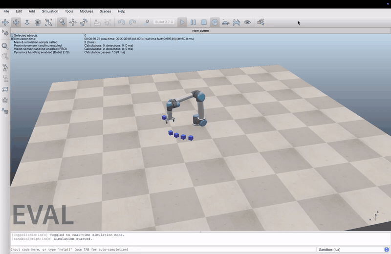

# PLC-controlled pick-and-place cell (OpenPLC + CoppeliaSim)

A personal learning project: a simulated **UR5** robot with an **RG2** gripper picks up to ten
cubes and places them, while the whole sequence is driven by a **PLC program written in
Structured Text** and executed by OpenPLC.

The PLC owns the logic (state machine, step sequence, piece counter, alarm). A small Python
script executes each step in the simulator and reports back. They talk over Modbus TCP.

```
OpenPLC Runtime (Docker)  <-- Modbus TCP :502 -->  cella_esecutore.py  -- ZMQ remote API -->  CoppeliaSim (UR5 + RG2)
         ^
         '-- plc_cmd.py   (terminal commands: run, stop, pieces, mode, ...)
```

## Demo
[](docs/demo.mp4)

Click the animation to open the full video (`docs/demo.mp4`): the PLC drives the UR5 through a
five-piece run in CoppeliaSim.

## Features
- PLC state machine: IDLE / RUNNING / STOPPED / ALARM, with a 30 s watchdog (TON) on the robot feedback
- 10-step pick-and-place sequence decided by the PLC (`cmd_step`), acknowledged by the robot (`done_step`)
- Automatic or manual mode (manual: one step per `advance` command)
- Multi-piece runs: up to 10 cubes, each in its own pick slot and its own drop slot. The executor
  creates exactly as many cubes as the piece target (`pezzi N`), also while the PLC is idle.
  Above 10 pieces the 10 slots are recycled (`slot = pezzi_fatti MOD 10`), which is handy for
  endurance tests (`pezzi 50`). The robot goes home only before the first piece and after the last one
- Gripper opens/closes with a width limit, so the fingers stop at the cube size

## Requirements
- Docker Desktop
- OpenPLC Editor 4.3.x (desktop app) and OpenPLC Runtime v4 (Docker image below)
- [CoppeliaSim](https://www.coppeliarobotics.com/) 4.10 (Edu or Pro)
- Python 3: `pip install pymodbus coppeliasim-zmqremoteapi-client scipy numpy`

Developed and tested on a MacBook Air (Apple Silicon).

## Setup (first time)
Start the PLC runtime:
```
docker run -d --name openplc-runtime -p 8443:8443 -p 502:502 \
  --cap-add=SYS_NICE --cap-add=SYS_RESOURCE \
  -v openplc-runtime-data:/var/run/runtime \
  ghcr.io/autonomy-logic/openplc-runtime:latest
```
In OpenPLC Editor open the project `cella/` (board: *OpenPLC Runtime v4*, host `localhost`).
Under *Servers* the Modbus server must be **Enabled**, TCP, port 502, with Buffer Mapping
**%QW = 16** and **%MW = 16**.

## Run
1. Docker Desktop running, then `docker start openplc-runtime` (check with `docker ps`: `healthy`).
2. OpenPLC Editor: connect to the runtime and **Build and upload** `cella/` (needed after every change to the ST code).
3. CoppeliaSim: open a new scene (simulation stopped) and run
   `python3 ricostruisci_scena.py` to build the scene (UR5, RG2, cube).
   Pass `--models <path>` if the script cannot find CoppeliaSim's `models` folder
   (macOS: `/Applications/coppeliaSim.app/Contents/Resources/models`).
   CoppeliaSim in evaluation mode cannot save scenes, which is why the scene is rebuilt by script.
4. `python3 cella_esecutore.py` starts the simulation, creates the cubes and waits for the PLC
   (Ctrl+C to quit).
5. In another terminal, send commands:

| Command | Effect |
|---|---|
| `python3 plc_cmd.py pezzi N` | number of pieces to process (cubes appear on the table; above 10 the slots are reused) |
| `python3 plc_cmd.py modo auto` / `modo man` | automatic mode / one step at a time |
| `python3 plc_cmd.py run` | start the sequence |
| `python3 plc_cmd.py avanti` | manual mode: allow the next step |
| `python3 plc_cmd.py stop` | stop (state STOPPED); `run` resumes |
| `python3 plc_cmd.py reset` | leave ALARM (30 s timeout on the robot feedback) |
| `python3 plc_cmd.py stato` | print state, mode, pieces done / target |

Typical session: `modo auto`, `pezzi 5`, `run`.

## PLC program (`cella/`, program `sequenza`, Structured Text)
States: 0 IDLE, 1 RUNNING, 2 STOPPED, 3 ALARM.

Steps (`cmd_step` from the PLC, `done_step` from the robot):
1 new piece (+ home if first), 2 above cube, 3 down, 4 grasp, 5 up, 6 above drop point,
7 down, 8 release, 9 up, 10 end of piece (+ home if last).

Modbus map (holding registers; compact mapping: %QW0..15 -> 0..15, %MW0..15 -> 16..31):

| Reg | Variable | Direction |
|---|---|---|
| 0 | `cmd_step` | PLC -> robot |
| 1 | `state` | PLC -> robot |
| 2 | `pezzi_fatti` (pieces done) | PLC -> robot |
| 3 | `slot` (`pezzi_fatti MOD 10`) | PLC -> robot |
| 4 | `ultimo` (1 if the current piece is the last) | PLC -> robot |
| 16 | `done_step` | robot -> PLC |
| 17 | `run` | command |
| 18 | `reset` | command |
| 19 | `pezzi_target` (pieces to do) | command |
| 20 | `modo` (0 auto, 1 manual) | command |
| 21 | `avanti` (advance one step) | command |

## Repository layout
- `cella/` OpenPLC project of the cell; `primo_motore/`, `lampeggiante/`, `semaforo/` earlier learning exercises (ladder motor latch, blinker with TON, traffic-light state machine)
- `cella_esecutore.py` PLC <-> CoppeliaSim executor
- `plc_cmd.py` command-line control of the PLC
- `ricostruisci_scena.py` rebuilds the CoppeliaSim scene (UR5, RG2, patched gripper script, cube)
- `pose_pinza.json` joint poses, generated by `calcola_pose_pinza.py` (numerical inverse kinematics; rerun with the simulation stopped only if the gripper or positions change)

Note: comments and console messages are in English, but some identifiers and the CLI words are
Italian: `pezzi`, `modo`, `avanti`, `ultimo`, `pezzi_fatti` mean pieces, mode, advance, last, pieces done.
The three earlier PLC exercises still have Italian variable names and comments.

## Implementation notes
- The grasp is simulated: the cube is re-parented to the gripper's attach point (static, not
  respondable), and the fingers stop at the cube width through an extra `RG2_hold` signal added
  to the RG2 Lua script (it uses CRLF line endings). Release: detach the cube first, then open.
- The fingertips are 4.3 cm beyond the attach point, so the grasp poses put the point between the
  fingertips at the cube center.
- Rotating around the base is a rotation of joint 1, so every slot reuses the same joint poses with a
  different base angle. Pick slots sit at base angle 7 + 12k degrees (k = 0..9, about 11 cm apart),
  drop slots at -40 - 12k degrees on the other side of the base, so the two arcs never overlap.
- Objects created while the simulation runs (the cubes) disappear when it stops, so the executor
  recreates them at every start.
- In Structured Text the last assignment in a scan cycle wins, so the order of the statements matters.
